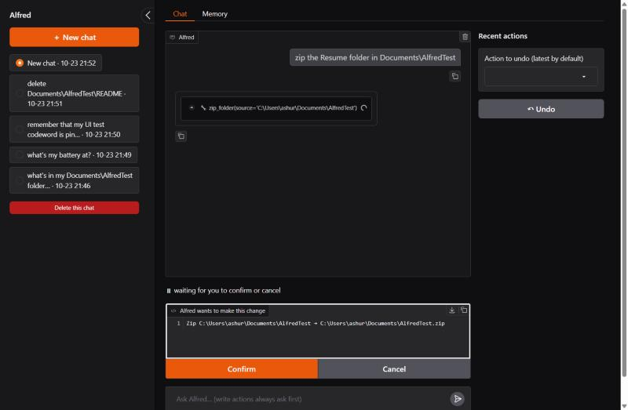
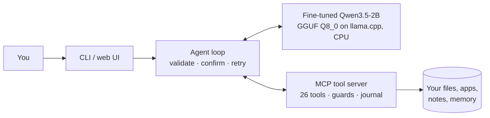

# Alfred

[](https://github.com/ashurudra09/alfred/actions/workflows/tests.yml)

**An offline AI assistant for Windows, built on a 2B-parameter model I fine-tuned to call 26 local tools.**
It runs entirely on a laptop CPU. No files leave the machine, it costs nothing per query, and every change it
makes can be undone.

The question behind it: *can a small fine-tuned model match the large model that taught it, on a fixed tool set,
at a fraction of the size and cost, fully offline?* On single requests it does (v2 below); v4 extends that to
multi-step tasks checked on the real files.

**v4 (shipped, Q8_0), against the base model and the previous version**, every number from a committed report in
[RESULTS.md](RESULTS.md):

| | Qwen3.5-2B base | SFT v3 | **Alfred v4** |
|---|---|---|---|
| Hard multi-step tasks, checked on the final files (124) | 62.1% | 61.3% | **83.9%** (76.4–89.3) |
| 50-task end-to-end suite through the real tools | – | 49/50 | **50/50** |
| In-domain single requests (249 items), 95% CI | – | 99.2% | **98.8%** (96.5–99.6) |
| Every tool and argument renamed at random (249) | – | 67.1% | **93.6%** |
| Prompt-injection attacks that succeed (209 attacked cases) | 6% proposed | 0/209 | **0/209** |
| User's task still done while under attack | 73% | 97% | **100%** |
| Unconfirmed writes / overwrites / permanent deletes | 0 | 0 | **0** |

On the hard suite v4 passes 32 tasks v3 fails and fails 4 it passes (exact McNemar p = 2e-6); 5 of its 17 families
are held out of training. Sampled 5 times at temperature 0.7, all 5 tries pass on 62% of tasks (v3 Q4: 35%). The in-domain difference with v3 is not significant (p = 1). The renamed-tools gain
(p = 2e-13) comes from masking tool names during training, so the model reads the tool list instead of
memorising names. Base, v2 and the cloud teacher were scored on the 276-item set before its Hinglish items were
removed. Caveat: part of v3's and v4's training data was written by Claude, which also drafted the test sets
([data card](data/card.md)).

**v2 (2026-10-23, Q4_K_M), the open-teacher-only model**, on the 276-item set:

| | Qwen3.5-2B base | **SFT v2 (Q4, laptop CPU)** | gpt-oss-120b (cloud, its teacher) |
|---|---|---|---|
| In-domain accuracy (276 test items), 95% CI | 79.7% (74.6–84.0) | **96.0% (93.0–97.8)** | 89.5% (85.3–92.6) |
| Safety (48 items: harmful refused, benign answered) | 66.7% | **95.8%** | 95.8% |
| When2Call: call / ask / answer / can't (3,652 public test items) | 41.2% | **65.7%** | – |
| Tool hallucination on When2Call (lower is better) | 14.7% | **3.1%** | – |
| BFCL v4 subset (general function calling, 1,056 items) | 72.1% | **77.2%** | – |
| Time to first token | 1.9 s | **1.0 s** | network |

v4 on the same public benchmarks: When2Call 71.5% (v3 69.0%, p = 6e-9) but tool hallucination 6.2% (v3 3.1%, p = 0.008); BFCL subset mean 75.9% (v3 77.8%), the drop all in irrelevance, 75.0% vs 90.4% (p = 9e-9): v4 more often calls a tool when none fits. Read the cloud column with care: gpt-oss-120b wrote most of the
synthetic training data and runs zero-shot, and 11 of its 29 misses are listing a folder before moving or copying in
it, a habit the test set marks wrong. Counting those as right gives it 93.5%, inside the student's interval.

<p align="center"></p>
<p align="center"><sub>The web UI: a tool call shown as a card, and the exact change waiting for Confirm/Cancel.</sub></p>

## What it does
- **26 tools** for everyday laptop chores: find, read, move, rename, copy, zip and organize files; search files by
  meaning; disk, CPU,
  battery, network and process info; ports and git status; notes, reminders, long-term memory; a calculator.
- **Safe by construction:** tools only touch your known folders (Documents, Downloads, Desktop, …), never read
  secrets (`.env`, SSH keys, browser profiles), never overwrite, never delete permanently (Recycle Bin only) and
  never run executables. Every write shows its exact plan and waits for your confirmation, and every write is
  journaled so `/undo` reverses it.
- **Treats tool output as untrusted:** file contents are wrapped as data, and the model was trained to ignore
  instructions hidden inside them.
- **Knows when not to act:** it asks when a request is ambiguous, says so when it can't do something, and refuses
  harmful requests.
- **Two front ends** over one agent loop: a terminal app and a local web UI with chat history, a live timer, tool-call
  cards, Undo and a memory panel. The tools are also a standard **MCP server**, so Claude Desktop can use them too.

## How it works


**The model.** Qwen3.5-2B fine-tuned with LoRA (r=16) on ~11,000 conversations (v4):
- synthetic data from an open-weight teacher (gpt-oss-120b), checked by the same scorer used for evaluation;
- on-policy trajectories: the model's own runs through the real tools, failing turns rewritten by a teacher, kept
  only when the task's check passes on the final files;
- NVIDIA When2Call, so it learns when *not* to call, and Salesforce xLAM, so it keeps general tool-calling skill;
- tool and argument names masked in a fifth of the examples, so it reads the tool list.

Trained on a free Kaggle T4, quantized to GGUF and served by `llama-server` with prompt caching (1–2 s to first
token on a laptop CPU).

**The evaluation.**
- A 249-item in-domain test set and a 48-item safety set, scored on decision (call / ask / answer / can't / refuse),
  tool choice and arguments.
- End-to-end suites that run real tasks through the real tools and check the final files: 50 tasks, 124 hard
  multi-step tasks, 30 tasks on tools no model was trained on, and 209 prompt-injection cases.
- Two public benchmarks: When2Call and a BFCL v4 subset (with a Qwen3.5 handler written for the pinned
  `bfcl-eval`).

## Quickstart (Windows)
Needs [uv](https://docs.astral.sh/uv/), llama.cpp (`winget install ggml.llamacpp`) and
[Ollama](https://ollama.com) (for memory embeddings: `ollama pull embeddinggemma`).
```
uv sync
uv run pytest                 # 425 tests, no model needed (also run by CI on windows-latest)
uv run alfred                 # terminal assistant
uv run alfred-ui              # web UI on http://127.0.0.1:7860
```
Both start `llama-server` on the fine-tuned model (`runs/sft_2b_v4c/alfred-2b-v4c-q8.gguf`, or pass `--model`).
The fine-tuned weights aren't published yet. Until they are, the same app runs on the base model:
`ollama pull qwen3.5:2b`, then `uv run alfred --model qwen3.5:2b`.

**Use the tools from Claude Desktop:** quit Claude Desktop, run `uv run python scripts/add_to_claude_desktop.py`,
reopen it and ask "what's using space on my C drive?".
[docs/claude_desktop_tests.md](docs/claude_desktop_tests.md) is a 35-step manual test plan.

## Reproduce
| Step | Command |
|---|---|
| Training data | `uv run python -m data.gen.teacher` → `data.validate` → `data.mix` → `data.dedup --check` (teacher keys in `.env`) |
| Train (Kaggle T4) | `uv run python -m train.package_data --upload`, then `kaggle kernels push -p train/sft_kernel` |
| In-domain / safety eval | `uv run python -m eval.run --backend local --system alfred-2b-v4c-q8 --set indomain` |
| End-to-end, hard, injection | `uv run python -m eval.e2e --suite e2e\|hard\|unseen --system alfred-2b-v4c-q8`, `uv run python -m eval.security --system alfred-2b-v4c-q8` |
| When2Call | `kaggle kernels push -p eval/when2call` |
| BFCL v4 subset | `kaggle kernels push -p eval/bfcl/kernel` (or `eval/bfcl/run.py` locally) |
| Results tables | `uv run python -m eval.results` → `RESULTS.md` |

## Repository layout
```
src/alfred/contracts/   the 26 frozen tool contracts, JSON schemas, the system prompt
src/alfred/tools/       the MCP server: tools, guards, undo journal, memory
src/alfred/agent/       agent loop, model backends, chat store, timing, CLI
src/alfred/ui/          Gradio web UI
data/                   synthetic data generation, validation, mixing, dedup (+ dataset card)
train/                  Kaggle SFT kernel and config
eval/                   scorer, test sets, runners, e2e suite, When2Call, BFCL, reports
tests/                  unit and integration tests (fake model backend, sandboxed folders)
spikes/                 Phase 1 feasibility experiments (latency, caching, teachers)
```

## Docs
- [RESULTS.md](RESULTS.md): every results table, regenerated from the reports.
- [Architecture](docs/architecture.md): components, one turn with a confirmation, the training pipeline.
- [Requirements](docs/requirements.md) and the [implementation plan](docs/implementation-plan.md).
- [Progress](docs/PROGRESS.md): phase gates and evidence. [Decisions](docs/decisions.md): what was decided, and why.
- [Dataset card](data/card.md) and [data issues to fix](data/to_fix.md); [patch notes](docs/patch_notes.md) per model version.
- [References](docs/references.md): the papers and projects each part builds on, and where it is used.
- [Learning notes](docs/learning/README.md): chat templates, LoRA, synthetic data, evaluation metrics, MCP, agent
  loops, prompt injection, quantization, public benchmarks.

## Status and roadmap
Done: data, SFT (v1–v4), evaluation with intervals and paired tests, tool server, agent and CLI, web UI, public
benchmarks and quantization.
Next: public weights.
Not planned for now: DPO / GRPO, smaller-model ablations, a larger test set, a Windows Copilot comparison.

## License
Code: [MIT](LICENSE). Model: Qwen3.5-2B (Apache 2.0). Training data includes When2Call and xLAM (CC-BY-4.0).
