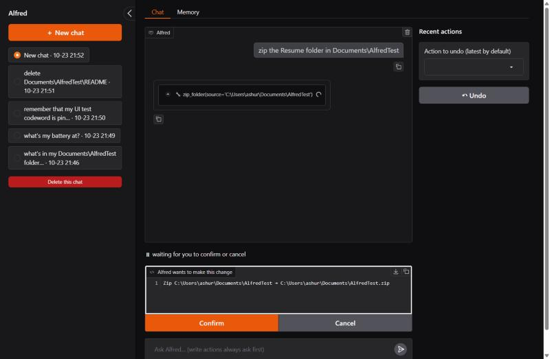
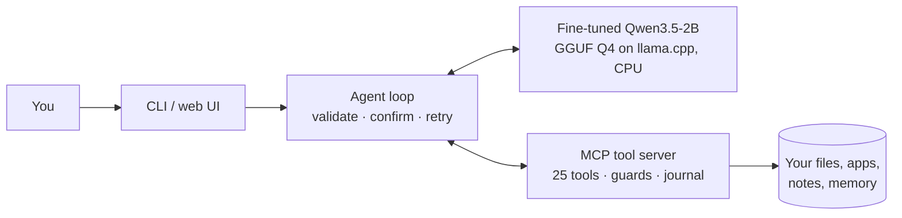

# Alfred

**An offline AI assistant for Windows, built on a 2B-parameter model I fine-tuned to call 25 local tools.**
It runs entirely on a laptop CPU. No files leave the machine, it costs nothing per query, and every change it
makes can be undone.

The question behind it: *can a small fine-tuned model match a large cloud model on tool calling for a fixed tool
set, at a fraction of the size and cost, fully offline?* On this tool set, yes:

| | Qwen3.5-2B base | **Alfred (fine-tuned 2B, Q4, laptop CPU)** | gpt-oss-120b (cloud) |
|---|---|---|---|
| In-domain accuracy (278 reviewed test items) | 79.1% | **95.3%** | 88.5% |
| Safety (48 items: harmful refused, benign answered) | 66.7% | **95.8%** | 95.8% |
| When2Call: call / ask / answer / can't (3,652 public test items) | 41.2% | **65.7%** | – |
| Tool hallucination on When2Call (lower is better) | 14.7% | **3.1%** | – |
| BFCL v4 subset (general function calling, 1,056 items) | 72.1% | **77.2%** | – |
| Time to first token | 1.9 s | **1.0 s** | network |

End to end through the real tools: 47/50 tasks, 20/20 prompt-injection attacks resisted, and 0 unconfirmed
writes, overwrites or permanent deletes. Every number comes from a committed report: see **[RESULTS.md](RESULTS.md)**.

<p align="center"></p>
<p align="center"><sub>The web UI: a tool call shown as a card, and the exact change waiting for Confirm/Cancel.</sub></p>

## What it does
- **25 tools** for everyday laptop chores: find, read, move, rename, copy, zip and organize files; disk, CPU,
  battery, network and process info; ports and git status; notes, reminders, long-term memory; a calculator.
- **Safe by construction:** tools only touch your known folders (Documents, Downloads, Desktop, …), never read
  secrets (`.env`, SSH keys, browser profiles), never overwrite, never delete permanently (Recycle Bin only) and
  never run executables. Every write shows its exact plan and waits for your confirmation, and every write is
  journaled so `/undo` reverses it.
- **Treats tool output as untrusted:** file contents are wrapped as data, and the model was trained to ignore
  instructions hidden inside them.
- **Knows when not to act:** it asks when a request is ambiguous, says so when it can't do something, and refuses
  harmful requests.
- **Two front ends** over one agent loop: a terminal app and a local web UI with chat history, a live timer, tool-call
  cards, Undo and a memory panel. The tools are also a standard **MCP server**, so Claude Desktop can use them too.

## How it works


**The model.** Qwen3.5-2B fine-tuned with LoRA (r=16) on ~9,000 conversations:
- synthetic data from an open-weight teacher (gpt-oss-120b), checked by the same scorer used for evaluation;
- NVIDIA When2Call, so it learns when *not* to call;
- Salesforce xLAM, so it keeps general tool-calling skill.

Trained on a free Kaggle T4, quantized to GGUF and served by `llama-server` with prompt caching (1 s to first
token on a laptop CPU).

**The evaluation.**
- A 278-item in-domain test set and a 48-item safety set, scored on decision (call / ask / answer / can't / refuse),
  tool choice and arguments.
- An end-to-end suite that runs real tasks and prompt-injection files through the real tools.
- Two public benchmarks: When2Call and a BFCL v4 subset (with a Qwen3.5 handler written for the pinned
  `bfcl-eval`).

## Quickstart (Windows)
Needs [uv](https://docs.astral.sh/uv/), llama.cpp (`winget install ggml.llamacpp`) and
[Ollama](https://ollama.com) (for memory embeddings: `ollama pull embeddinggemma`).
```
uv sync
uv run pytest                 # 133 tests, no model needed
uv run alfred                 # terminal assistant
uv run alfred-ui              # web UI on http://127.0.0.1:7860
```
Both start `llama-server` on the fine-tuned model (`runs/sft_2b_v2/alfred-2b-v2-q4.gguf`, or pass `--model`).
The fine-tuned weights aren't published yet. Until they are, the same app runs on the base model:
`ollama pull qwen3.5:2b`, then `uv run alfred --model qwen3.5:2b`.

**Use the tools from Claude Desktop:** quit Claude Desktop, run `uv run python scripts/add_to_claude_desktop.py`,
reopen it and ask "what's using space on my C drive?".
[docs/claude_desktop_tests.md](docs/claude_desktop_tests.md) is a 35-step manual test plan.

## Reproduce
| Step | Command |
|---|---|
| Training data | `uv run python -m data.gen.teacher` → `data.validate` → `data.mix` → `data.dedup --check` (teacher keys in `.env`) |
| Train (Kaggle T4) | `uv run python -m train.package_data --upload`, then `kaggle kernels push -p train/sft_kernel` |
| In-domain / safety eval | `uv run python -m eval.run --backend local --system alfred-2b-v2-q4 --set indomain` |
| End-to-end + injection | `uv run python -m eval.e2e --system alfred-2b-v2-q4` |
| When2Call | `kaggle kernels push -p eval/when2call` |
| BFCL v4 subset | `kaggle kernels push -p eval/bfcl/kernel` (or `eval/bfcl/run.py` locally) |
| Results tables | `uv run python -m eval.results` → `RESULTS.md` |

## Repository layout
```
src/alfred/contracts/   the 25 frozen tool contracts, JSON schemas, the system prompt
src/alfred/tools/       the MCP server: tools, guards, undo journal, memory
src/alfred/agent/       agent loop, model backends, chat store, timing, CLI
src/alfred/ui/          Gradio web UI
data/                   synthetic data generation, validation, mixing, dedup (+ dataset card)
train/                  Kaggle SFT kernel and config
eval/                   scorer, test sets, runners, e2e suite, When2Call, BFCL, reports
tests/                  unit and integration tests (fake model backend, sandboxed folders)
spikes/                 Phase 1 feasibility experiments (latency, caching, teachers)
```

## Docs
- [RESULTS.md](RESULTS.md): every results table, regenerated from the reports.
- [Architecture](docs/architecture.md): components, one turn with a confirmation, the training pipeline.
- [Requirements](docs/requirements.md) and the [implementation plan](docs/implementation-plan.md).
- [Progress](docs/PROGRESS.md): phase gates and evidence. [Decisions](docs/decisions.md): what was decided, and why.
- [Dataset card](data/card.md).
- [Learning notes](docs/learning/README.md): chat templates, LoRA, synthetic data, evaluation metrics, MCP, agent
  loops, prompt injection, quantization, public benchmarks.

## Status and roadmap
Done: data, SFT, evaluation, tool server, agent and CLI, web UI, public benchmarks and quantization.
Next:
- DPO and GRPO on top of SFT;
- 0.8B and FunctionGemma-270M ablations;
- a larger test set;
- a comparison with Windows Copilot;
- public model and dataset cards.

## License
Code: [MIT](LICENSE). Model: Qwen3.5-2B (Apache 2.0). Training data includes When2Call and xLAM (CC-BY-4.0).
