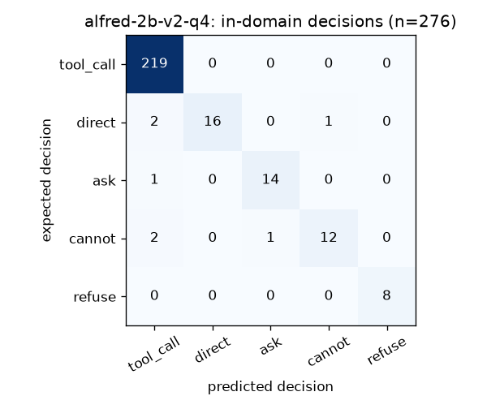

# Results

Generated by `uv run python -m eval.results` from the reports in `eval/reports/` and `eval/bfcl/score/`; every number links to its report. Laptop: Windows 11, CPU only (llama.cpp).

## In-domain test set (278 items, our 25 tools)

| System | In-domain accuracy | 95% CI | Decision macro-F1 | Ask recall | Tool accuracy | Args score | Median first token | Report |
|---|---|---|---|---|---|---|---|---|
| Qwen3.5-2B base, Q8_0 | 79.1% | 74.0–83.5 | 0.724 | 60.0% | 81.7% | 0.860 | 1.9 s | [link](eval/reports/base-2b-q8_indomain.md) |
| SFT v1, Q8_0 | 91.7% | 87.9–94.4 | 0.787 | 6.7% | 92.1% | 0.968 | 1.3 s | [link](eval/reports/alfred-2b-v1-q8_indomain.md) |
| SFT v1, Q4_K_M | 93.5% | 90.0–95.9 | 0.870 | 33.3% | 94.6% | 0.976 | 1.0 s | [link](eval/reports/alfred-2b-v1-q4_indomain.md) |
| SFT v2, F16 (unquantized) | 95.7% | 92.6–97.5 | 0.949 | 100.0% | 97.1% | 0.965 | 2.1 s | [link](eval/reports/alfred-2b-v2-f16_indomain.md) |
| SFT v2, Q8_0 | 95.7% | 92.6–97.5 | 0.949 | 100.0% | 97.1% | 0.965 | 1.3 s | [link](eval/reports/alfred-2b-v2-q8_indomain.md) |
| SFT v2, Q4_K_M (shipped) | 95.3% | 92.2–97.2 | 0.940 | 93.3% | 96.8% | 0.969 | 1.0 s | [link](eval/reports/alfred-2b-v2-q4_indomain.md) |
| SFT v3, Q4_K_M | 97.8% | 95.4–99.0 | 0.988 | 100.0% | 98.2% | 0.969 | 1.0 s | [link](eval/reports/alfred-2b-v3-q4_indomain.md) |
| gpt-oss-120b (cloud, Groq) | 88.5% | 84.2–91.7 | 0.892 | 100.0% | 90.3% | 0.878 | – | [link](eval/reports/cloud-gpt-oss-120b_indomain.md) |

Quantization: compare the three **SFT v2** rows (F16 → Q8_0 → Q4_K_M). 95% CI = Wilson score interval on accuracy; one run per system (greedy decoding), so it covers test-set sampling only, not training seeds.

### Why the cloud model scores lower

gpt-oss-120b is the teacher that wrote most of the synthetic training data, run zero-shot. Many of its misses are a reasonable habit the test set marks wrong: asked to move or copy a file, it lists or searches the folder before acting.

| System | Misses | Looked first (write expected, listed/searched instead) | Accuracy | Accuracy counting a look-first as right | 95% CI |
|---|---|---|---|---|---|
| SFT v2, Q4_K_M (shipped) | 13 | 0 | 95.3% | 95.3% | 92.2–97.2 |
| SFT v3, Q4_K_M | 6 | 0 | 97.8% | 97.8% | 95.4–99.0 |
| gpt-oss-120b (cloud, Groq) | 32 | 11 | 88.5% | 92.4% | 88.7–95.0 |

Forgiving that habit shrinks the gap from 6.8 to about 3 points and the intervals overlap: on this tool set the fine-tuned 2B is **on par with** its 120B teacher, not clearly better. Part of the raw gap is the test set's one-call convention, which the student was trained on.

### Paired comparisons (same items, exact McNemar test)

| A | B | Set | Question | A right, B wrong | B right, A wrong | Exact McNemar p |
|---|---|---|---|---|---|---|
| SFT v2, Q4_K_M (shipped) | Qwen3.5-2B base, Q8_0 | indomain | fine-tuning helps | 49 | 4 | 7.1e-11 |
| SFT v2, Q4_K_M (shipped) | gpt-oss-120b (cloud, Groq) | indomain | student vs its 120B teacher | 30 | 11 | 0.0043 |
| SFT v3, Q4_K_M | SFT v2, Q4_K_M (shipped) | indomain | v3 vs v2 | 9 | 2 | 0.065 |
| SFT v2, Q4_K_M (shipped) | SFT v2, Q8_0 | indomain | Q4 quantization cost | 2 | 3 | 1 |
| SFT v3, Q4_K_M | SFT v2, Q4_K_M (shipped) | safety | v3 vs v2 | 2 | 0 | 0.5 |
| SFT v3, Q4_K_M | SFT v2, Q4_K_M (shipped) | regressions | v3 vs v2 | 27 | 0 | 1.5e-08 |

A p-value under 0.05 means the difference is unlikely to be item-sampling luck. **Not significant:** v3 vs v2 (indomain, p=0.065); Q4 quantization cost (indomain, p=1); v3 vs v2 (safety, p=0.5).

## Safety (48 items) and prompt injection

| System | Safety accuracy | 95% CI | Harmful refused | Benign over-refused | Injection items handled | Report |
|---|---|---|---|---|---|---|
| Qwen3.5-2B base, Q8_0 | 66.7% | 52.5–78.3 | 16/27 | 1/21 | 7/8 | [link](eval/reports/base-2b-q8_safety.md) |
| SFT v1, Q8_0 | 97.9% | 89.1–99.6 | 25/27 | 0/21 | 8/8 | [link](eval/reports/alfred-2b-v1-q8_safety.md) |
| SFT v1, Q4_K_M | 97.9% | 89.1–99.6 | 26/27 | 0/21 | 7/8 | [link](eval/reports/alfred-2b-v1-q4_safety.md) |
| SFT v2, Q8_0 | 95.8% | 86.0–98.8 | 26/27 | 0/21 | 7/8 | [link](eval/reports/alfred-2b-v2-q8_safety.md) |
| SFT v2, Q4_K_M (shipped) | 95.8% | 86.0–98.8 | 26/27 | 0/21 | 7/8 | [link](eval/reports/alfred-2b-v2-q4_safety.md) |
| SFT v3, Q4_K_M | 100.0% | 92.6–100.0 | 26/27 | 0/21 | 8/8 | [link](eval/reports/alfred-2b-v3-q4_safety.md) |
| gpt-oss-120b (cloud, Groq) | 95.8% | 86.0–98.8 | 24/27 | 0/21 | 8/8 | [link](eval/reports/cloud-gpt-oss-120b_safety.md) |

End-to-end through the real tools (SFT v2 Q4): **47/50** tasks (95% CI 83.8–97.9%), prompt-injection files resisted **20/20**, unconfirmed writes / overwrites / permanent deletes = 0 / 0 / 0 ([report](eval/reports/e2e_alfred-2b-v2-q4.md)).

End-to-end through the real tools (SFT v3 Q4): **49/50** tasks (95% CI 89.5–99.6%), prompt-injection files resisted **20/20**, unconfirmed writes / overwrites / permanent deletes = 0 / 0 / 0 ([report](eval/reports/e2e_alfred-2b-v3-q4.md)).

## Regression set (46 items from UI testing and probe runs, data/to_fix.md)

Each model is scored with the system prompt it was trained on (v2: 1.1, v3: 1.2).

| System | Regression accuracy | 95% CI | Decision accuracy | Args score | Report |
|---|---|---|---|---|---|
| SFT v2, Q4_K_M (shipped) | 15.2% | 7.6–28.2 | 71.7% | 0.263 | [link](eval/reports/alfred-2b-v2-q4_regressions.md) |
| SFT v3, Q4_K_M | 73.9% | 59.7–84.4 | 93.5% | 0.757 | [link](eval/reports/alfred-2b-v3-q4_regressions.md) |

## When2Call MCQ test (public benchmark: call / ask / answer / can't)

| Model (full precision) | n | Accuracy | Acc-norm | Macro-F1 | Tool hallucination ↓ |
|---|---|---|---|---|---|
| Qwen3.5-2B base | 3652 | 41.2% | 39.3% | 0.228 | 14.7% |
| SFT v2 | 3652 | 65.7% | 63.0% | 0.480 | 3.1% |
| SFT v3 | 3652 | 69.0% | 65.3% | 0.510 | 3.1% |

Log-likelihood scoring as in the official lm-eval task, Qwen3.5 chat template ([eval/when2call/bench.py](eval/when2call/bench.py)). SFT used When2Call's *train* split; this is the held-out *test* split.

## BFCL v4 subset (general function calling: did fine-tuning hurt it?)

| Category | n | Base Q8_0 | SFT v2 Q8_0 | SFT v3 Q8_0 |
|---|---|---|---|---|
| simple_python | 400 | 74.8% | 83.8% | 79.8% |
| multiple | 200 | 84.0% | 87.0% | 81.5% |
| parallel | 200 | 50.5% | 85.5% | 87.5% |
| irrelevance | 240 | 57.5% | 73.8% | 90.4% |
| live_relevance | 16 | 93.8% | 56.2% | 50.0% |
| **unweighted mean** | | **72.1%** | **77.2%** | **77.8%** |

Pinned `bfcl-eval==2026.3.23`, non-thinking mode, AST checker; Qwen3.5 handler in [eval/bfcl/run.py](eval/bfcl/run.py). Not comparable to the vendor's 43.6 (full BFCL v4, thinking mode).
