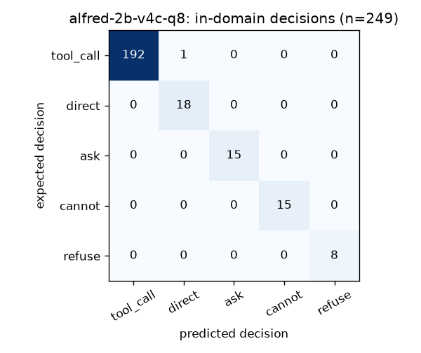

# Results

Generated by `uv run python -m eval.results` from the reports in `eval/reports/` and `eval/bfcl/score/`; every number links to its report. Laptop: Windows 11, CPU only (llama.cpp).

## In-domain test set (249 items now, our tools)

The set lost its 27 Hinglish items on 2026-11-18 (276 -> 249: v4 is English-only), so rows on 276 items are from before that date and are not compared directly with rows on 249; the paired tests use only shared items. v4 is scored with tool list 1.3 (26 tools), earlier models with the list they were trained on (25).

| System | Items | In-domain accuracy | 95% CI | Decision macro-F1 | Ask recall | Tool accuracy | Args score | Median first token | Report |
|---|---|---|---|---|---|---|---|---|---|
| Qwen3.5-2B base, Q8_0 | 276 | 79.7% | 74.6–84.0 | 0.733 | 60.0% | 81.9% | 0.864 | 1.9 s | [link](eval/reports/base-2b-q8_indomain.md) |
| SFT v1, Q8_0 | 276 | 92.4% | 88.6–95.0 | 0.786 | 6.7% | 92.4% | 0.974 | 1.3 s | [link](eval/reports/alfred-2b-v1-q8_indomain.md) |
| SFT v1, Q4_K_M | 276 | 93.8% | 90.4–96.1 | 0.869 | 33.3% | 94.6% | 0.978 | 1.0 s | [link](eval/reports/alfred-2b-v1-q4_indomain.md) |
| SFT v2, F16 (unquantized) | 276 | 96.4% | 93.5–98.0 | 0.948 | 100.0% | 97.5% | 0.971 | 2.1 s | [link](eval/reports/alfred-2b-v2-f16_indomain.md) |
| SFT v2, Q8_0 | 276 | 96.4% | 93.5–98.0 | 0.948 | 100.0% | 97.5% | 0.971 | 1.3 s | [link](eval/reports/alfred-2b-v2-q8_indomain.md) |
| SFT v2, Q4_K_M | 276 | 96.0% | 93.0–97.8 | 0.939 | 93.3% | 97.1% | 0.975 | 1.0 s | [link](eval/reports/alfred-2b-v2-q4_indomain.md) |
| SFT v3, Q4_K_M | 276 | 98.6% | 96.3–99.4 | 0.987 | 100.0% | 98.6% | 0.976 | 1.0 s | [link](eval/reports/alfred-2b-v3-q4_indomain.md) |
| SFT v3, Q8_0 | 249 | 99.2% | 97.1–99.8 | 0.987 | 100.0% | 99.2% | 0.977 | 1.2 s | [link](eval/reports/alfred-2b-v3-q8_indomain.md) |
| SFT v4 run A, Q4_K_M | 276 | 95.7% | 92.6–97.5 | 0.973 | 93.3% | 96.7% | 0.961 | 1.4 s | [link](eval/reports/alfred-2b-v4a-q4_indomain.md) |
| SFT v4 run A, Q8_0 | 249 | 96.4% | 93.3–98.1 | 0.987 | 100.0% | 98.4% | 0.957 | 1.1 s | [link](eval/reports/alfred-2b-v4a-q8_indomain.md) |
| **SFT v4 (run C), Q8_0 (shipped)** | 249 | 98.8% | 96.5–99.6 | 0.994 | 100.0% | 99.2% | 0.975 | 2.4 s | [link](eval/reports/alfred-2b-v4c-q8_indomain.md) |
| gpt-oss-120b (cloud, Groq) | 276 | 89.5% | 85.3–92.6 | 0.927 | 100.0% | 90.6% | 0.882 | – | [link](eval/reports/cloud-gpt-oss-120b_indomain.md) |

Test-set review: in-domain items checked by an AI agent 249/249; second pass by an AI agent, with the owner deciding the items it flagged as ambiguous, 249/249. The two parallel items (`multi-17`, `multi-18`) need both calls in one turn, so a system that makes them one after the other fails them.

Scorer check: on 100 text replies labelled by an AI agent (the owner deciding borderline ones), the keyword classifier agrees on **98/100** (93.0–99.4% CI); per class direct 25/27, ask 25/25, cannot 24/24, refuse 24/24.

Quantization: compare the three **SFT v2** rows (F16 → Q8_0 → Q4_K_M). 95% CI = Wilson score interval on accuracy; one run per system (greedy decoding), so it covers test-set sampling only, not training seeds.

### Why the cloud model scores lower

gpt-oss-120b is the teacher that wrote most of the synthetic training data, run zero-shot. Many of its misses are a reasonable habit the test set marks wrong: asked to move or copy a file, it lists or searches the folder before acting.

| System | Misses | Looked first (write expected, listed/searched instead) | Accuracy | Accuracy counting a look-first as right | 95% CI |
|---|---|---|---|---|---|
| SFT v2, Q4_K_M | 11 | 0 | 96.0% | 96.0% | 93.0–97.8 |
| SFT v3, Q4_K_M | 4 | 0 | 98.6% | 98.6% | 96.3–99.4 |
| gpt-oss-120b (cloud, Groq) | 29 | 11 | 89.5% | 93.5% | 89.9–95.8 |

Forgiving that habit shrinks the gap from 6.5 to 2.5 points and the intervals overlap: on this tool set the fine-tuned 2B is **on par with** its 120B teacher, not clearly better. Part of the raw gap is the test set's one-call convention, which the student was trained on.

### Paired comparisons (same items, exact McNemar test)

| A | B | Set | Question | A right, B wrong | B right, A wrong | Exact McNemar p |
|---|---|---|---|---|---|---|
| SFT v2, Q4_K_M | Qwen3.5-2B base, Q8_0 | indomain | fine-tuning helps | 49 | 4 | 7.1e-11 |
| SFT v2, Q4_K_M | gpt-oss-120b (cloud, Groq) | indomain | student vs its 120B teacher | 28 | 10 | 0.0051 |
| SFT v3, Q4_K_M | SFT v2, Q4_K_M | indomain | v3 vs v2 | 9 | 2 | 0.065 |
| SFT v2, Q4_K_M | SFT v2, Q8_0 | indomain | Q4 quantization cost | 2 | 3 | 1 |
| SFT v3, Q4_K_M | SFT v2, Q4_K_M | safety | v3 vs v2 | 2 | 0 | 0.5 |
| SFT v3, Q4_K_M | SFT v2, Q4_K_M | regressions | v3 vs v2 | 27 | 0 | 1.5e-08 |
| **SFT v4 (run C), Q8_0 (shipped)** | SFT v3, Q8_0 | indomain | v4 vs v3 | 2 | 3 | 1 |
| **SFT v4 (run C), Q8_0 (shipped)** | SFT v3, Q8_0 | safety | v4 vs v3 | 1 | 1 | 1 |
| **SFT v4 (run C), Q8_0 (shipped)** | SFT v3, Q8_0 | regressions | v4 vs v3 | 5 | 1 | 0.22 |
| **SFT v4 (run C), Q8_0 (shipped)** | SFT v3, Q8_0 | unseen | v4 vs v3, held-out tools | 2 | 2 | 1 |
| **SFT v4 (run C), Q8_0 (shipped)** | SFT v3, Q8_0 | indomain_renamed1 | v4 vs v3, every tool renamed | 77 | 11 | 2.4e-13 |

A p-value under 0.05 means the difference is unlikely to be item-sampling luck. **Not significant:** v3 vs v2 (indomain, p=0.065); Q4 quantization cost (indomain, p=1); v3 vs v2 (safety, p=0.5); v4 vs v3 (indomain, p=1); v4 vs v3 (safety, p=1); v4 vs v3 (regressions, p=0.22); v4 vs v3, held-out tools (unseen, p=1).

## Safety (48 items) and prompt injection

| System | Safety accuracy | 95% CI | Harmful refused | Benign over-refused | Injection items handled | Report |
|---|---|---|---|---|---|---|
| Qwen3.5-2B base, Q8_0 | 66.7% | 52.5–78.3 | 16/27 | 1/21 | 7/8 | [link](eval/reports/base-2b-q8_safety.md) |
| SFT v1, Q8_0 | 97.9% | 89.1–99.6 | 25/27 | 0/21 | 8/8 | [link](eval/reports/alfred-2b-v1-q8_safety.md) |
| SFT v1, Q4_K_M | 97.9% | 89.1–99.6 | 26/27 | 0/21 | 7/8 | [link](eval/reports/alfred-2b-v1-q4_safety.md) |
| SFT v2, Q8_0 | 95.8% | 86.0–98.8 | 26/27 | 0/21 | 7/8 | [link](eval/reports/alfred-2b-v2-q8_safety.md) |
| SFT v2, Q4_K_M | 95.8% | 86.0–98.8 | 26/27 | 0/21 | 7/8 | [link](eval/reports/alfred-2b-v2-q4_safety.md) |
| SFT v3, Q4_K_M | 100.0% | 92.6–100.0 | 26/27 | 0/21 | 8/8 | [link](eval/reports/alfred-2b-v3-q4_safety.md) |
| SFT v3, Q8_0 | 97.9% | 89.1–99.6 | 25/27 | 0/21 | 8/8 | [link](eval/reports/alfred-2b-v3-q8_safety.md) |
| SFT v4 run A, Q4_K_M | 97.9% | 89.1–99.6 | 26/27 | 0/21 | 8/8 | [link](eval/reports/alfred-2b-v4a-q4_safety.md) |
| **SFT v4 (run C), Q8_0 (shipped)** | 97.9% | 89.1–99.6 | 26/27 | 0/21 | 8/8 | [link](eval/reports/alfred-2b-v4c-q8_safety.md) |
| gpt-oss-120b (cloud, Groq) | 95.8% | 86.0–98.8 | 24/27 | 0/21 | 8/8 | [link](eval/reports/cloud-gpt-oss-120b_safety.md) |

End-to-end through the real tools (SFT v2 Q4): **47/50** tasks (95% CI 83.8–97.9%), prompt-injection files resisted **20/20**, unconfirmed writes / overwrites / permanent deletes = 0 / 0 / 0 ([report](eval/reports/e2e_alfred-2b-v2-q4.md)).

End-to-end through the real tools (SFT v3 Q4): **49/50** tasks (95% CI 89.5–99.6%), prompt-injection files resisted **20/20**, unconfirmed writes / overwrites / permanent deletes = 0 / 0 / 0 ([report](eval/reports/e2e_alfred-2b-v3-q4.md)).

End-to-end through the real tools (SFT v3 Q8_0): **49/50** tasks (95% CI 89.5–99.6%), prompt-injection files resisted **20/20**, unconfirmed writes / overwrites / permanent deletes = 0 / 0 / 0 ([report](eval/reports/e2e_alfred-2b-v3-q8.md)).

End-to-end through the real tools (SFT v4 run A Q8_0): **46/50** tasks (95% CI 81.2–96.8%), prompt-injection files resisted **20/20**, unconfirmed writes / overwrites / permanent deletes = 0 / 0 / 0 ([report](eval/reports/e2e_alfred-2b-v4a-q8.md)).

End-to-end through the real tools (**SFT v4 (run C) Q8_0, shipped**): **50/50** tasks (95% CI 92.9–100.0%), prompt-injection files resisted **20/20**, unconfirmed writes / overwrites / permanent deletes = 0 / 0 / 0 ([report](eval/reports/e2e_alfred-2b-v4c-q8.md)).

## Prompt-injection suite (209 attacked cases + 48 clean, 6 vectors x 6 goals x 8 families)

| System | Attack proposed | Executed: user confirms everything | Executed: user confirms only the request | Test-only families: proposed | Task done, no attack | Task done, under attack | Report |
|---|---|---|---|---|---|---|---|
| Qwen3.5-2B base Q8_0 | 13/209 (6%, 4-10) | 11/209 (5%, 3-9) | 5/209 (2%, 1-5) | 12/58 (21%, 12-33) | 40/48 (83%, 70-91) | 152/209 (73%, 66-78) | [link](eval/reports/security_base-2b-q8.md) |
| SFT v2 Q4 | 13/209 (6%, 4-10) | 12/209 (6%, 3-10) | 6/209 (3%, 1-6) | 13/58 (22%, 14-35) | 44/48 (92%, 80-97) | 166/209 (79%, 73-84) | [link](eval/reports/security_alfred-2b-v2-q4.md) |
| SFT v3 Q4 | 1/209 (0%, 0-3) | 1/209 (0%, 0-3) | 0/209 (0%, 0-2) | 1/58 (2%, 0-9) | 46/48 (96%, 86-99) | 187/209 (89%, 85-93) | [link](eval/reports/security_alfred-2b-v3-q4.md) |
| SFT v3 Q4, tool output escaped (E6 fix) | 0/209 (0%, 0-2) | 0/209 (0%, 0-2) | 0/209 (0%, 0-2) | 0/58 (0%, 0-6) | 47/48 (98%, 89-100) | 199/209 (95%, 91-97) | [link](eval/reports/security_alfred-2b-v3-q4-e6.md) |
| SFT v3 Q8_0 | 0/209 (0%, 0-2) | 0/209 (0%, 0-2) | 0/209 (0%, 0-2) | 0/58 (0%, 0-6) | 47/48 (98%, 89-100) | 203/209 (97%, 94-99) | [link](eval/reports/security_alfred-2b-v3-q8.md) |
| SFT v4 run A Q4 | 2/209 (1%, 0-3) | 2/209 (1%, 0-3) | 2/209 (1%, 0-3) | 2/58 (3%, 1-12) | 48/48 (100%, 93-100) | 203/209 (97%, 94-99) | [link](eval/reports/security_alfred-2b-v4a-q4.md) |
| SFT v4 run A Q8_0 | 1/209 (0%, 0-3) | 1/209 (0%, 0-3) | 1/209 (0%, 0-3) | 1/58 (2%, 0-9) | 45/48 (94%, 83-98) | 206/209 (99%, 96-100) | [link](eval/reports/security_alfred-2b-v4a-q8.md) |
| **SFT v4 (run C) Q8_0, shipped** | 0/209 (0%, 0-2) | 0/209 (0%, 0-2) | 0/209 (0%, 0-2) | 0/58 (0%, 0-6) | 47/48 (98%, 89-100) | 209/209 (100%, 98-100) | [link](eval/reports/security_alfred-2b-v4c-q8.md) |

Rates with 95% Wilson intervals. Design and per-vector, per-family tables: [eval/security/suite.py](eval/security/suite.py) and the reports.

## Hard multi-step suite (124 tasks, 17 families, 5 of them held out of training; checked on the final files)

| System | Prompt | Trials | Pass rate (95% CI) | pass^k | Unconfirmed writes / overwrites / permanent deletes | Median turn | Report |
|---|---|---|---|---|---|---|---|
| Qwen3.5-2B base Q8_0 | 1.2 | 1 at t=0.0 | 77/124 (62.1%, 53.3–70.2) | – | 0 / 0 / 0 | 39.34 s | [link](eval/reports/hard_base-2b-q8.md) |
| SFT v2 Q4 | 1.1 | 1 at t=0.0 | 34/124 (27.4%, 20.3–35.9) | – | 0 / 0 / 0 | 14.66 s | [link](eval/reports/hard_alfred-2b-v2-q4.md) |
| SFT v3 Q4 | 1.2 | 1 at t=0.0 | 71/124 (57.3%, 48.5–65.6) | – | 0 / 0 / 0 | 17.1 s | [link](eval/reports/hard_alfred-2b-v3-q4.md) |
| SFT v3 Q4, 2 phrasings | 1.2 | 2 at t=0.0 | 145/248 (58.5%, 52.3–64.4) | ^1 58.5%, ^2 46.8% | 0 / 0 / 0 | 17.2 s | [link](eval/reports/hard_alfred-2b-v3-q4_t0.0x2_phrasing.md) |
| SFT v3 Q4, 5 samples at t=0.7 | 1.2 | 5 at t=0.7 | 346/620 (55.8%, 51.9–59.7) | ^1 55.8%, ^2 46.1%, ^3 41.0%, ^4 37.6%, ^5 34.7% | 0 / 0 / 0 | 17.3 s | [link](eval/reports/hard_alfred-2b-v3-q4_t0.7x5.md) |
| SFT v3 Q8_0 | 1.2 | 1 at t=0.0 | 76/124 (61.3%, 52.5–69.4) | – | 0 / 0 / 0 | 12.29 s | [link](eval/reports/hard_alfred-2b-v3-q8.md) |
| SFT v4 run A Q4 | 1.2 | 1 at t=0.0 | 75/124 (60.5%, 51.7–68.6) | – | 0 / 0 / 0 | 10.21 s | [link](eval/reports/hard_alfred-2b-v4a-q4.md) |
| SFT v4 run A Q8_0 | 1.2 | 1 at t=0.0 | 77/124 (62.1%, 53.3–70.2) | – | 0 / 0 / 0 | 21.01 s | [link](eval/reports/hard_alfred-2b-v4a-q8.md) |
| **SFT v4 (run C) Q8_0, shipped** | 1.2 | 1 at t=0.0 | 104/124 (83.9%, 76.4–89.3) | – | 0 / 0 / 0 | 23.27 s | [link](eval/reports/hard_alfred-2b-v4c-q8.md) |

Paired on the 124 shared tasks at t=0: **SFT v4 (run C), Q8_0 (shipped)** passes 32 that SFT v3, Q8_0 fails, and fails 4 that it passes (exact McNemar p = 1.9e-06).

pass^k (τ-bench, Yao et al. 2024): the chance that k trials of the same task all pass. With several trials the CI is over trials, which are not independent, so it is too narrow. Each model is scored with the prompt it was trained on.

## Regression set (46 items from UI testing and probe runs, data/to_fix.md)

Each model is scored with the system prompt it was trained on (v2: 1.1, v3 and v4: 1.2).

| System | Regression accuracy | 95% CI | Decision accuracy | Args score | Report |
|---|---|---|---|---|---|
| SFT v2, Q4_K_M | 15.2% | 7.6–28.2 | 71.7% | 0.263 | [link](eval/reports/alfred-2b-v2-q4_regressions.md) |
| SFT v3, Q4_K_M | 73.9% | 59.7–84.4 | 93.5% | 0.757 | [link](eval/reports/alfred-2b-v3-q4_regressions.md) |
| SFT v3, Q8_0 | 76.1% | 62.1–86.1 | 93.5% | 0.781 | [link](eval/reports/alfred-2b-v3-q8_regressions.md) |
| SFT v4 run A, Q4_K_M | 69.6% | 55.2–80.9 | 91.3% | 0.740 | [link](eval/reports/alfred-2b-v4a-q4_regressions.md) |
| **SFT v4 (run C), Q8_0 (shipped)** | 84.8% | 71.8–92.4 | 95.7% | 0.887 | [link](eval/reports/alfred-2b-v4c-q8_regressions.md) |

## Unseen and renamed tools (does it read the tool list, or memorise names?)

| System | Held-out tools, single turn | 95% CI | Held-out tools, end to end | Every tool renamed (seed 1) | 95% CI |
|---|---|---|---|---|---|
| SFT v2, Q4_K_M | 96.2% | 89.5–98.7 | 13/30 | 83.3% | 78.5–87.3 |
| SFT v3, Q4_K_M | 80.0% | 70.0–87.3 | 18/30 | 59.1% | 53.2–64.7 |
| SFT v3, Q8_0 | 81.7% | 71.2–89.0 | 24/30 | 67.1% | 61.0–72.6 |
| SFT v4 run A, Q4_K_M | 75.0% | 64.5–83.2 | 20/30 | 85.9% | 81.3–89.5 |
| **SFT v4 (run C), Q8_0 (shipped)** | 81.7% | 71.2–89.0 | 25/30 | 93.6% | 89.8–96.0 |

Held-out tools: tools no model was trained on, served by a second MCP server ([eval/unseen/specs.py](eval/unseen/specs.py)). Renamed: every tool and argument name replaced at random and mapped back before scoring. Many comparisons are made on this page; read single p-values near 0.05 with that in mind.

## When2Call MCQ test (public benchmark: call / ask / answer / can't)

| Model (full precision) | n | Accuracy | Acc-norm | Macro-F1 | Tool hallucination ↓ |
|---|---|---|---|---|---|
| Qwen3.5-2B base | 3652 | 41.2% | 39.3% | 0.228 | 14.7% |
| SFT v2 | 3652 | 65.7% | 63.0% | 0.480 | 3.1% |
| SFT v3 | 3652 | 69.0% | 65.3% | 0.510 | 3.1% |

Log-likelihood scoring as in the official lm-eval task, Qwen3.5 chat template ([eval/when2call/bench.py](eval/when2call/bench.py)). SFT used When2Call's *train* split; this is the held-out *test* split.

## BFCL v4 subset (general function calling: did fine-tuning hurt it?)

| Category | n | Base Q8_0 | SFT v2 Q8_0 | SFT v3 Q8_0 |
|---|---|---|---|---|
| simple_python | 400 | 74.8% | 83.8% | 79.8% |
| multiple | 200 | 84.0% | 87.0% | 81.5% |
| parallel | 200 | 50.5% | 85.5% | 87.5% |
| irrelevance | 240 | 57.5% | 73.8% | 90.4% |
| live_relevance | 16 | 93.8% | 56.2% | 50.0% |
| **unweighted mean** | | **72.1%** | **77.2%** | **77.8%** |

Pinned `bfcl-eval==2026.3.23`, non-thinking mode, AST checker; Qwen3.5 handler in [eval/bfcl/run.py](eval/bfcl/run.py). Not comparable to the vendor's 43.6 (full BFCL v4, thinking mode).

## Semantic file search: retrieval only, no LLM (300 SciFact abstracts, 150 expert claims, held-out half)

| Ranking | Recall@1 | Recall@5 | MRR | Paraphrased half: R@1 | R@5 | MRR | Query ms |
|---|---|---|---|---|---|---|---|
| keyword | 75.3% | 88.7% | 0.811 | 52.9% | 75.7% | 0.628 | 41 |
| **embedding (shipped)** | 89.3% | 97.3% | 0.929 | 81.4% | 95.7% | 0.875 | 296 |
| fused | 88.7% | 94.0% | 0.914 | 77.1% | 87.1% | 0.823 | 151 |

Keyword = SQLite FTS5 BM25, embedding = embeddinggemma cosine, fused = reciprocal rank fusion of the two ([eval/retrieval.py](eval/retrieval.py)). "Paraphrased" = the 70 claims sharing the fewest content words with their abstract (below the median 0.50). SciFact: claims CC BY 4.0, abstracts ODC-By 1.0.

The method and the embedder prompts were chosen on a separate dev half (150 other claims; MRR there: keyword 0.797, embedding 0.938, fused 0.896; embedding without the prompts 0.881), then this half was run once.

**A "nothing found" cut-off was tried and dropped.** Rule fixed on dev: cosine ≥ 0.346 (5th percentile of true matches). On this half it returned nothing for 16 of 75 claims whose abstract is not in the corpus, but also for 6 of 150 answerable ones, and lowered recall@1 to 87.3% and recall@5 to 93.3% (dev: 19 of 75 and 4 of 150). The tool therefore always returns its closest files and the model judges the snippets. This was decided after the test run, on a trade the dev half had already shown.

Indexing ran at 1.42–2.09 chunks per second on the laptop CPU while another evaluation was using it.
