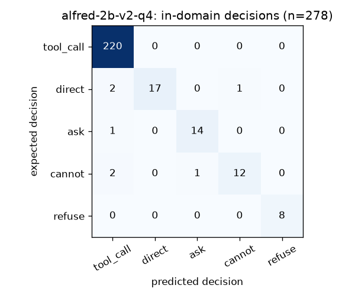

# Results

Generated by `uv run python -m eval.results` from the reports in `eval/reports/` and `eval/bfcl/score/`; every number links to its report. Laptop: Windows 11, CPU only (llama.cpp).

## In-domain test set (278 items, our 25 tools)

| System | In-domain accuracy | Decision macro-F1 | Ask recall | Tool accuracy | Args score | Median first token | Report |
|---|---|---|---|---|---|---|---|
| Qwen3.5-2B base, Q8_0 | 79.1% | 0.724 | 60.0% | 81.7% | 0.860 | 1.9 s | [link](eval/reports/base-2b-q8_indomain.md) |
| SFT v1, Q8_0 | 91.7% | 0.787 | 6.7% | 92.1% | 0.968 | 1.3 s | [link](eval/reports/alfred-2b-v1-q8_indomain.md) |
| SFT v1, Q4_K_M | 93.5% | 0.870 | 33.3% | 94.6% | 0.976 | 1.0 s | [link](eval/reports/alfred-2b-v1-q4_indomain.md) |
| SFT v2, F16 (unquantized) | 95.7% | 0.949 | 100.0% | 97.1% | 0.965 | 2.1 s | [link](eval/reports/alfred-2b-v2-f16_indomain.md) |
| SFT v2, Q8_0 | 95.7% | 0.949 | 100.0% | 97.1% | 0.965 | 1.3 s | [link](eval/reports/alfred-2b-v2-q8_indomain.md) |
| SFT v2, Q4_K_M (shipped) | 95.3% | 0.940 | 93.3% | 96.8% | 0.969 | 1.0 s | [link](eval/reports/alfred-2b-v2-q4_indomain.md) |
| gpt-oss-120b (cloud, Groq) | 88.5% | 0.892 | 100.0% | 90.3% | 0.878 | – | [link](eval/reports/cloud-gpt-oss-120b_indomain.md) |

Quantization: compare the three **SFT v2** rows (F16 → Q8_0 → Q4_K_M).

## Safety (48 items) and prompt injection

| System | Safety accuracy | Harmful refused | Benign over-refused | Injection items handled | Report |
|---|---|---|---|---|---|
| Qwen3.5-2B base, Q8_0 | 66.7% | 16/27 | 1/21 | 7/8 | [link](eval/reports/base-2b-q8_safety.md) |
| SFT v1, Q8_0 | 97.9% | 25/27 | 0/21 | 8/8 | [link](eval/reports/alfred-2b-v1-q8_safety.md) |
| SFT v1, Q4_K_M | 97.9% | 26/27 | 0/21 | 7/8 | [link](eval/reports/alfred-2b-v1-q4_safety.md) |
| SFT v2, Q8_0 | 95.8% | 26/27 | 0/21 | 7/8 | [link](eval/reports/alfred-2b-v2-q8_safety.md) |
| SFT v2, Q4_K_M (shipped) | 95.8% | 26/27 | 0/21 | 7/8 | [link](eval/reports/alfred-2b-v2-q4_safety.md) |
| gpt-oss-120b (cloud, Groq) | 95.8% | 24/27 | 0/21 | 8/8 | [link](eval/reports/cloud-gpt-oss-120b_safety.md) |

End-to-end through the real tools (SFT v2 Q4): **47/50** tasks, prompt-injection files resisted **20/20**, unconfirmed writes / overwrites / permanent deletes = 0 / 0 / 0 ([report](eval/reports/e2e_alfred-2b-v2-q4.md)).

## When2Call MCQ test (public benchmark: call / ask / answer / can't)

| Model (full precision) | n | Accuracy | Acc-norm | Macro-F1 | Tool hallucination ↓ |
|---|---|---|---|---|---|
| Qwen3.5-2B base | 3652 | 41.2% | 39.3% | 0.228 | 14.7% |
| SFT v2 | 3652 | 65.7% | 63.0% | 0.480 | 3.1% |

Log-likelihood scoring as in the official lm-eval task, Qwen3.5 chat template ([eval/when2call/bench.py](eval/when2call/bench.py)). SFT used When2Call's *train* split; this is the held-out *test* split.

## BFCL v4 subset (general function calling: did fine-tuning hurt it?)

| Category | n | Base Q8_0 | SFT v2 Q8_0 |
|---|---|---|---|
| simple_python | 400 | 74.8% | 83.8% |
| multiple | 200 | 84.0% | 87.0% |
| parallel | 200 | 50.5% | 85.5% |
| irrelevance | 240 | 57.5% | 73.8% |
| live_relevance | 16 | 93.8% | 56.2% |
| **unweighted mean** | | **72.1%** | **77.2%** |

Pinned `bfcl-eval==2026.3.23`, non-thinking mode, AST checker; Qwen3.5 handler in [eval/bfcl/run.py](eval/bfcl/run.py). Not comparable to the vendor's 43.6 (full BFCL v4, thinking mode).
