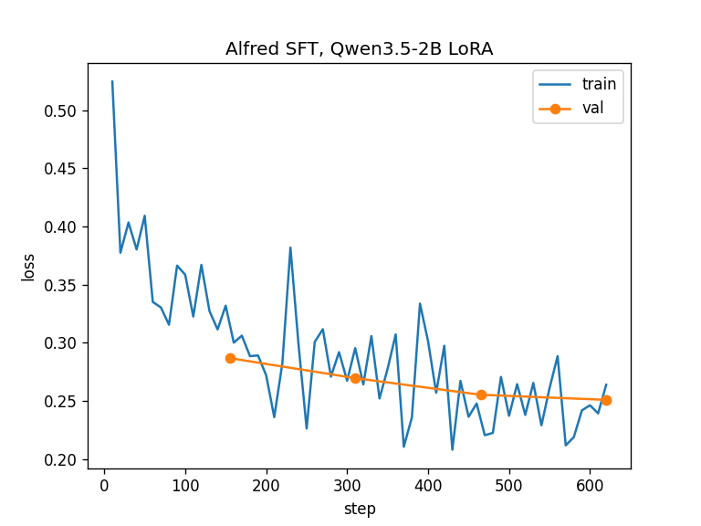

# Progress

Each phase gate adds one line to the log below. Full detail for each phase is in [implementation-plan.md](implementation-plan.md).

## Phase status

| # | Phase | Milestone | Status | Gate passed | Evidence |
|---|---|---|---|---|---|
| 0 | Repo & accounts setup | M1 | done | 2026-10-22 | `scripts/check_setup.py`: all 10 required + 3 optional checks OK |
| 1 | Feasibility spikes | M1 | done | 2026-10-22 | `spikes/*.py`; numbers in decisions.md |
| 2 | Tool contracts | M1 | done | 2026-10-22 | `pytest tests/contracts` (11 passed); tag `contracts-v1.0` |
| 3 | Eval harness, test sets & baselines | M1 | done | 2026-10-22 | `pytest tests/eval` (24 passed); `eval/reports/base-2b-q8_*`, `cloud-gpt-oss-120b_*`, rescore 20/20 |
| 4 | Training dataset | M1 | done | 2026-10-22 | `data/stats.md`; validate 96.8%, dedup --check 0 hits |
| 5 | SFT + export | M1 | done | 2026-10-23 | `eval/reports/alfred-2b-v2-q{4,8}_*`; in-domain 95.3% (v2 Q4) vs base 79.1% |
| D1 | Docs checkpoint 1: "the model works" | M1 (24 Oct) | done | 2026-10-23 | `docs/learning/` (4 notes); tag `checkpoint-D1` |
| 6 | Tool server | M2 | done (Inspector check optional) | 2026-10-23 | `pytest tests/tools` (35 passed incl. stdio server) |
| 7 | Agent runtime + CLI | M2 | done (offline run pending) | 2026-10-23 | `pytest tests/agent` (12 passed); [e2e report](../eval/reports/e2e_alfred-2b-v2-q4.md) 47/50, invariants 0 |
| 8 | Minimal web UI | M2 | done | 2026-10-23 | `pytest tests/ui` (2 passed); manual checklist with [screenshots](ui/) |
| 9 | Benchmarks, safety & ablations | M2 / M3 | not started | | |
| D2 | Docs checkpoint 2: "the product works" | M2 (31 Oct) | not started | | |
| 10 | DPO | M3 | not started | | |
| 11 | GRPO | M3 | not started | | |
| D3 | Docs checkpoint 3: "training story complete" | M3 | not started | | |
| 12 | Copilot comparison & release | M3 (Dec) | not started | | |

## Key numbers (M1, 2026-10-23)
Every number is from a report in `eval/reports/` (scorer v1.1). In-domain = 278 test items, safety = 48.

| System | In-domain accuracy | Decision F1 | Ask recall | Safety accuracy | Median time to first token (laptop CPU) | Report |
|---|---|---|---|---|---|---|
| Base Qwen3.5-2B (Q8) | 79.1% | 72.4% | 60% | 66.7% | 1.9 s | [in-domain](../eval/reports/base-2b-q8_indomain.md), [safety](../eval/reports/base-2b-q8_safety.md) |
| **Alfred SFT v2 (Q4, shipped)** | **95.3%** | **94.0%** | **93%** | **95.8%** | **1.0 s** | [in-domain](../eval/reports/alfred-2b-v2-q4_indomain.md), [safety](../eval/reports/alfred-2b-v2-q4_safety.md) |
| Alfred SFT v2 (Q8) | 95.7% | 94.9% | 100% | 95.8% | 1.3 s | [in-domain](../eval/reports/alfred-2b-v2-q8_indomain.md), [safety](../eval/reports/alfred-2b-v2-q8_safety.md) |
| Alfred SFT v1 (Q4) | 93.5% | 87.0% | 33% | 97.9% | 1.0 s | [in-domain](../eval/reports/alfred-2b-v1-q4_indomain.md), [safety](../eval/reports/alfred-2b-v1-q4_safety.md) |
| Cloud reference gpt-oss-120b (Groq) | 88.5% | 89.2% | 100% | 95.8% | 0.9 s | [in-domain](../eval/reports/cloud-gpt-oss-120b_indomain.md), [safety](../eval/reports/cloud-gpt-oss-120b_safety.md) |

- Fine-tuning gain: **+16.2 points** (v2 Q4 over base, in-domain); target was ≥ 15. Valid-call rate 100% for every local model.
- Refusal recall on the safety set: base 59.3% → v2 96.3%; no over-refusals on the borderline items.
- Training: 620 LoRA steps on one free Kaggle T4, 3.9 h; data 8,963 train examples ([data card](../data/card.md), [stats](../data/stats.md)); train summary [v2](../eval/reports/sft_2b_v2_train_summary.json), loss curve 

## Open issues
- **Test sets are not independent of Claude:** Claude drafted all items and an AI agent reviewed the in-domain set (owner-approved deviation); the owner reviewed most of the safety set.
- **Dataset top-up still running:** 28 of 584 generation batches remain (hourly Groq task `AlfredTopup`, deletes itself when done); 13 tools have 147–194 training examples instead of ≥ 200.
- **Remaining v2 errors (13/278 in-domain):** `recall` vs `search_files`, name vs content search, missing `by_date`, some "can't do" requests mapped to `open_app`, a direct question answered with a tool.
- **Scorer heuristics:** text replies are classified by keywords (checked against 20 hand-rescored items, all agreed; that sample had no refusal replies).
- **Training budget:** each SFT run takes ~4 h of float32 on a T4 (vs the planned ≤ 2 GPU-hours) and covers ~0.6 of an epoch.

## Next steps
1. Phase 9: BFCL / When2Call / safety / quantization benchmarks and ablations.
2. D2: docs checkpoint "the product works".

## Gate log
<!-- One line per gate: YYYY-MM-DD · phase · result · evidence -->
- 2026-10-22 · Phase 0 · passed · `uv run python scripts/check_setup.py` → all required checks OK (git, GitHub remote, uv, Ollama 0.40.8, HF write token, gated xLAM + FunctionGemma access, Kaggle API, Groq, Cerebras, 80 GB free); optional Gemini, Node, Claude Desktop OK. A bad key was confirmed to fail the check.
- 2026-10-22 · Phase 1 · passed with an open issue · tool calling 4/4, teacher 10/10 valid on 3 candidates, embedder embeddinggemma, Kaggle 2× T4; warm TTFT 20.9 s with 25 schemas (> 8 s rule → compact schemas required in Phase 2; latency fix pending owner decision)
- 2026-10-22 · Phase 1 latency · resolved (pending serving decision) · Ollama reprocesses the whole prompt per request (no prefix reuse for Qwen3.5); llama-server reuses 1,886 cached tokens → warm TTFT 2.1 s; saved prefix restores in ~125 ms → first request after restart 1.6–1.9 s
- 2026-10-22 · Phase 2 · passed · `uv run pytest tests/contracts` → 11 passed (25 names = spec, flags = spec, tools.json current, schemas meta-valid, deterministic date-only prompt, 2,279 prompt tokens); live llama-server check OK; tag `contracts-v1.0`
- 2026-10-22 · Phase 3 · harness done, gate pending · `uv run pytest` → 34 passed; provisional baselines in-domain 79.1% (base Q8) vs 87.8% (gpt-oss-120b), safety 68.0% vs 88.0%; waiting on owner review of 328 test items + 20-item hand rescoring
- 2026-10-22 · Phase 3 · passed (with deviation) · safety 48 owner-reviewed (6 by agent), in-domain 278 agent-reviewed (owner-approved); rescore 20/20 (agent); baselines in-domain base 79.1% vs gpt-oss-120b 88.5%, safety 66.7% vs 95.8%; `uv run pytest` 35 passed
- 2026-10-22 · Phase 4 · passed (with shortfall) · pilot 93.9% auto / 48/50 manual (Claude-checked); 5,915 valid synthetic + 1,268 When2Call + 1,268 xLAM → train 7,889 / val 415; `data.dedup --check` 0 hits; 15 tools under 200 examples
- 2026-10-23 · Phase 5 · passed with an open issue · SFT v1 620 steps (4.0 h T4), val loss 0.227; in-domain Q8 90.6% / Q4 92.4% vs base 79.1% vs gpt-oss-120b 88.5%; safety 97.9% vs base 66.7%; ask recall regressed to 7–33% (template render of earlier turns) → v2 fix
- 2026-10-23 · Phase 5 · passed · SFT v2 (ask fix): in-domain Q8 95.7% / Q4 95.3% vs base 79.1% (+16.2–16.6) vs gpt-oss-120b 88.5%; ask recall 93–100%; safety 95.8% vs base 66.7%; scorer v1.1 (default-valued omitted args); v1 kept as `alfred-2b-v1-*`
- 2026-10-23 · D1 · passed · PROGRESS key numbers (each linked to a report), open issues, next steps; README status + how-to-run; learning notes (chat templates, LoRA, synthetic data, eval metrics); relative-link check over docs: 0 broken
- 2026-10-23 · Phase 6 · passed (owner checks pending) · 25 tools behind the frozen contracts; `uv run pytest` 70 passed: every guard (allow-list, sensitive paths, junction escape, executables, no overwrite), happy/error paths, undo round-trip for move/rename/copy/zip/organize/recycle (real Recycle Bin restore) + notes/reminders/memory; stdio MCP client: list_tools = tools.json; real-machine smoke OK. Pending: MCP Inspector + Claude Desktop (owner)
- 2026-10-23 · Phase 7 · passed (owner offline check pending) · `uv run pytest` 83 passed; e2e 47/50 (94%) with SFT v2 Q4, injection 20/20, unconfirmed writes / overwrites / permanent deletes = 0 / 0 / 0; median turn 9 s; live CLI session OK
- 2026-10-23 · Phase 6 · owner check passed · tool robustness pass (130 tests); owner ran the Claude Desktop test plan (docs/claude_desktop_tests.md): all tools work from Claude Desktop
- 2026-10-23 · Phase 8 · passed · `uv run alfred-ui` (Gradio 6.30, 127.0.0.1 only, page requests only localhost); `uv run pytest` 132 passed incl. `tests/ui/test_smoke.py` (fake model via gradio_client: reply + timing; cancel = no change, confirm moves, undo restores); manual checklist on the real model, screenshots in docs/ui/: live timer, tool card + timing footer, confirm, cancel = no change, undo, continue an old chat, delete a chat, memory forget
