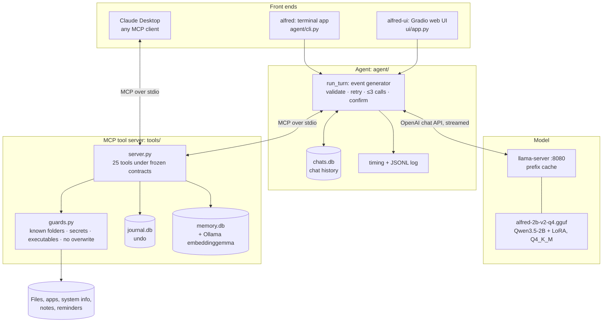
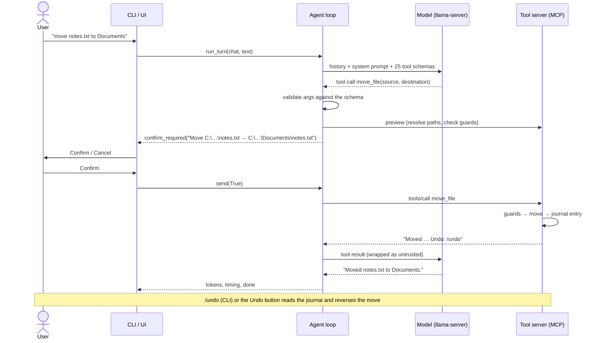
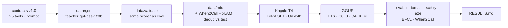

# Architecture

Alfred has three parts that meet at two interfaces: the **model** (behind an OpenAI-compatible HTTP API served by
llama.cpp) and the **tools** (behind MCP). The agent loop in the middle owns every safety rule.

## Components

## One turn with a write

On Cancel the loop sends the model "The user declined this change. Nothing was changed." and nothing runs.

## Training and evaluation pipeline

## Where things live
| Path | What |
|---|---|
| `src/alfred/contracts/` | tool contracts, JSON schemas (`tools.json`), system prompt, message schemas |
| `src/alfred/tools/` | MCP server, tool implementations, guards, undo journal, memory |
| `src/alfred/agent/` | agent loop, model backends, MCP client, chats, timing, CLI |
| `src/alfred/ui/` | web UI (consumes the loop's events only) |
| `data/`, `train/` | dataset generation and validation, Kaggle training |
| `eval/` | scorer, test sets, runners, e2e suite, BFCL and When2Call, `results.py` |
| `%LOCALAPPDATA%\Alfred\` | user data: `chats.db`, `journal.db`, `memory.db`, `notes\`, `reminders.json`, `config.json` |
